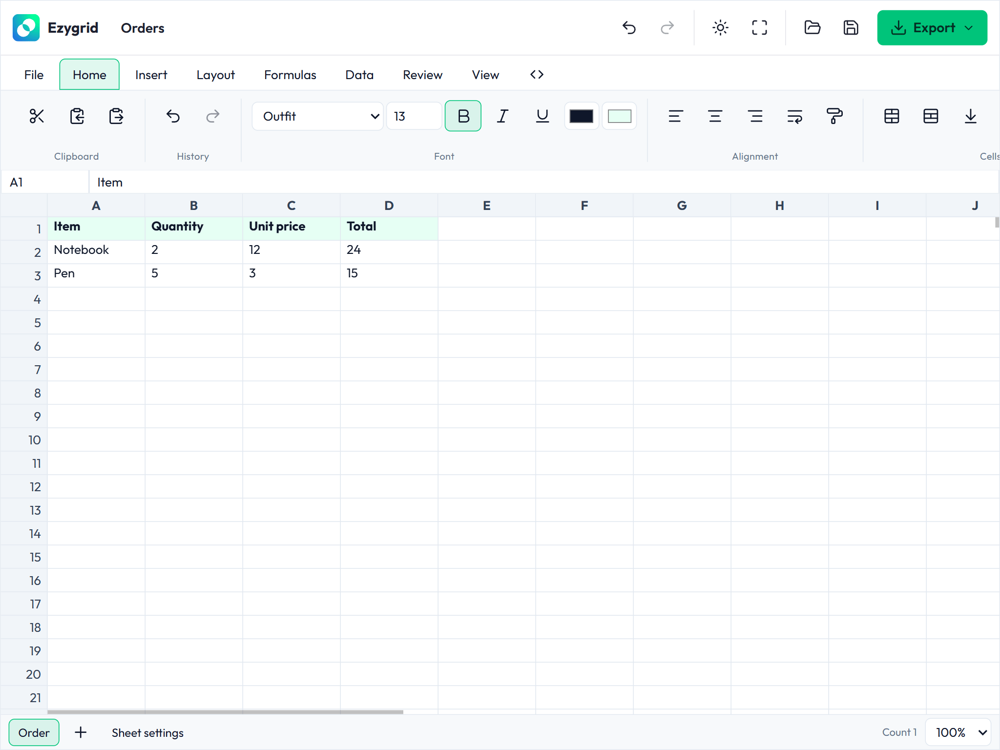

# ezygrid

[](https://opensource.org/licenses/MIT)
[](https://github.com/bookklik-technologies/ezygrid)

Framework-agnostic JavaScript/TypeScript spreadsheet and data-grid library by
[Bookklik Technologies](https://github.com/bookklik-technologies).



## Features

- Spreadsheet and data-grid engine with a workbook/worksheet facade
- Excel-compatible formula engine — lexer/parser/AST, dependency graph, function library
- Sparse document model with stable IDs, A1 utilities and a typed operation format
- Rendering, selection, editing and history
- Declarative (`data-ezg-editor`), programmatic and script-tag initialization
- Local workspace integrations for Angular, React, Vue and a web component (the npm root package is framework-neutral)

## Documentation

Full guides and API reference: <https://bookklik-technologies.github.io/ezygrid/>

- [Development skills](docs/guide/development-skills.md) — seven repository skills for AI-assisted workbook, formula, data-rule, visualization, file, plugin and UI development

## Quick start

### Declarative (script tag)

```html
<div data-ezg-editor style="height: 460px"></div>
<script src="https://unpkg.com/@bookklik/ezygrid/dist/ezygrid.umd.js"></script>
```

The UMD bundle mounts every `[data-ezg-editor]` host automatically and
exposes the `Ezygrid` global for programmatic use — no bundler required.

### npm / ESM

```bash
npm install @bookklik/ezygrid
```

```js
import { Ezygrid } from '@bookklik/ezygrid';

const editor = new Ezygrid({ target: '#editor' });
```

Optional official themes ship as CSS files:

```js
import '@bookklik/ezygrid/themes/default.css';
```

For script-tag deployments without a bundler you can also host the classic
loader (`dist/browser/`) from your static assets; it fetches its dependency
files relative to itself and enables declarative startup automatically.

### TypeScript

Type declarations are bundled with the package (`dist/index.d.ts`) — no
additional `@types` install is needed.

See [Getting started](docs/getting-started.md) for configuration, lifecycle,
and dynamic hosts.

## Examples

Runnable demos in the [examples folder](examples/README.md) — served via any
static server (e.g. WAMP: `http://localhost/ezygrid/examples/`).

## Development

```sh
pnpm install
pnpm test        # vitest across all packages
pnpm build       # tsc project references build
pnpm typecheck
```

## Status

v0.1.x — the public API is stabilizing; semver guarantees apply from 1.0.

## License

MIT
